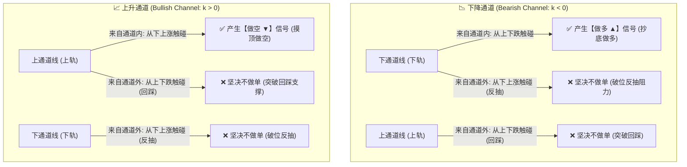
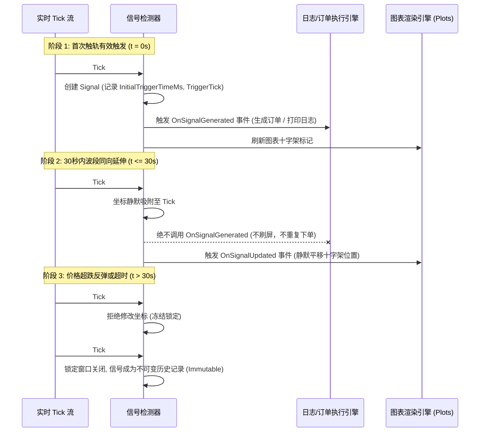

# 角度趋势通道与微观Tick极值吸附交易策略规格说明书
## (Macro Angle Channel with Micro Tick Vertex Refinement & Directional Boundary Approach Strategy)

---

## 1. 策略概述与设计哲学 (Strategy Philosophy)

### 1.1 核心思想
本策略是一种结合**大周期通道几何学（Macro Geometry）**与**微观逐笔Tick流式拓扑分析（Micro Tick Topology）**的均值回归与通道突破防护策略。
策略的核心设计哲学为**“顺中见逆，界内做反转，界外防破位”**：
1. **大周期通道确立基准**：通过大周期连续K线的形态演变，使用线性回归/极值包络线构建动态倾斜轨道（斜率 $k$、上轨 $Upper(t)$、下轨 $Lower(t)$、中轨 $Mid(t)$）。
2. **微观Tick流式吸附极值**：在触碰通道边界的瞬间，通过毫秒级实时Tick精准咬合在局部的波峰/波谷顶点，杜绝指标滞后性。
3. **入轨方向拓扑甄别（核心创新）**：通过状态机严格区分**“通道内部冲击支撑/阻力”**与**“通道外部破位反抽/突破回踩”**，杜绝在单边破位行情中逆势抄底接飞刀。
4. **严格零未来函数（Zero Lookahead）**：大周期通道形态必须在大周期K线**正式收盘定型（Close）**后方可确立；实时Tick流式派发，绝不使用盘后全知数据。

---

## 2. 策略关键参数规范 (Parameter Specifications)

| 参数名称 | 符号 | 建议默认值 | 作用描述 |
| :--- | :---: | :---: | :--- |
| **最小连续形态根数** | $N_{bars}$ | 2 根 | 大周期确认连续上涨或下跌的最小收盘K线根数门槛 |
| **形态累计涨跌幅度门槛** | $P_{min}$ | 0.1% | 连续波段累计涨跌幅的最低门槛，过滤窄幅横盘微弱震荡 |
| **微观聚合时间窗口** | $T_{agg}$ | 6 秒 (6000ms) | 流式Tick聚合微观K线的固定时间切片窗口 |
| **历史Tick回溯提取量** | $N_{ticks}$ | 10,000 笔 | 进入观察期瞬间向前提取的历史已定型Tick总笔数（消除冷启动盲区） |
| **触轨容差阈值** | $\delta$ | 0.02% (0.0002) | 判定价格触碰动态轨道边界的弹性缓冲区间 |
| **波段极值精炼窗口** | $T_{refine}$ | 30 秒 (30000ms) | 首次触轨后允许静默吸附同向更优极值Tick的时间锁定期 |
| **最小信号间隔时长** | $T_{interval}$ | 60 秒 (60000ms) | 两次跨K线交易信号之间的绝对最小安全时间冷却 |
| **通道最大有效前向投影** | $L_{proj}$ | 15 根K线 | 通道形成后最多向前延续预测的K线数量，超期自动注销 |

---

## 3. 数学模型与通道几何学计算 (Mathematical Modeling)

### 3.1 大周期趋势识别与通道构建
设大周期定型K线序列为 $B_0, B_1, \dots, B_m$。
当最新的连续 $n$ 根K线满足以下条件时，判定通道确立：
1. **连续同向收盘**：
   - 连续上涨：$\forall i \in [m-n+1, m], \ Close_i > Open_i$
   - 连续下跌：$\forall i \in [m-n+1, m], \ Close_i < Open_i$
2. **幅度满足门槛**：
   $$\Delta P = \frac{|Close_m - Open_{m-n+1}|}{Open_{m-n+1}} \ge P_{min}$$

### 3.2 动态轨道参数方程
通道由线性方程描述，横坐标采用浮点连续时间轴 $x \in \mathbb{R}$：
$$x(t) = BarIndex + \text{Clamp}\left(\frac{TickIndex}{TotalTicksInBar}, 0.0, 0.999\right)$$
- **斜率**：$k = \frac{Close_m - Open_{m-n+1}}{m - (m-n+1)} = \frac{Close_m - Open_{m-n+1}}{n-1}$
- **上轨截距与方程**：$Upper(x) = k \cdot x + UpperB$
- **下轨截距与方程**：$Lower(x) = k \cdot x + LowerB$
- **动态中轨方程**：$Mid(x) = \frac{Upper(x) + Lower(x)}{2} = k \cdot x + \frac{UpperB + LowerB}{2}$

---

## 4. 观察期微观聚合与冷启动基准 (Micro-Aggregation Engine)

### 4.1 10,000 笔 Tick 历史冷启动回溯
通道确立收盘时，向历史追溯调取最近已完成的 10,000 笔已发生真实 `RawTick`：
1. 对齐至 $6000\text{ms}$ 整点时间窗口：
   $$BucketMs = \lfloor \frac{Tick.Time}{6000} \rfloor \times 6000$$
2. 聚合生成历史 6 秒微观K线列表：
   $$Open = Tick_0.Price, \ High = \max(Tick.Price), \ Low = \min(Tick.Price), \ Close = Tick_{-1}.Price$$
3. 提取微观近端基准：$RecentMaxHigh = \max(High_{6s}), \ RecentMinLow = \min(Low_{6s})$。

### 4.2 实时流式演进
每个实时到来的 `RawTick`：
- 若属于当前 6s 柱时间窗口：动态更新当前 6s 柱的 $High = \max(High, Price), \ Low = \min(Low, Price), \ Close = Price$；
- 若跨越到新 6s 窗口：封闭前一根柱，推入观察期历史，并以当前 Tick 作为 Open 开启新柱。

---

## 5. 双层几何拓扑状态机与触轨方向法则 (Topological Boundary Logic)

### 5.1 交易信号方向矩阵



### 5.2 状态机状态定义与状态迁移规则

在上下文对象 `ChannelObservationContext` 中定义三个核心状态变量：
- `PriceWasBelowLower`（布尔值）：记录价格是否曾跌破下轨处于外部下方。
- `PriceWasAboveUpper`（布尔值）：记录价格是否曾冲破上轨处于外部上方。
- `LastTickPrice`（数值）：记录前一笔 Tick 成交价，用于判定即时动量偏向。

#### 状态迁移方程：
1. **越界判定（进入外部区域）**：
   - 当 $Price_t < Lower(t)$ 时：`PriceWasBelowLower = true`
   - 当 $Price_t > Upper(t)$ 时：`PriceWasAboveUpper = true`
2. **穿透中轨复位（回归通道内部闭环）**：
   - 当 $Price_t \ge Mid(t)$ 时：`PriceWasBelowLower = false` 且 `LongCooldown = false`
   - 当 $Price_t \le Mid(t)$ 时：`PriceWasAboveUpper = false` 且 `ShortCooldown = false`

### 5.3 进出场开仓判定逻辑

#### 规则 A：下降通道（Bearish）下轨做多触发条件
1. **触及下轨**：$Price \le Lower(t) \times (1 + \delta)$（容差范围内触碰下轨）
2. **微观极值**：$Price \le Current6sBar.Low$（创出当前 6s 柱最低点）
3. **入轨方向校验（核心）**：
   $$\text{IsFallingFromAbove} = (\neg PriceWasBelowLower) \ \land \ (Price \le PrevPrice \lor Price \le Current6sBar.Open)$$
   - 若 `PriceWasBelowLower == true`，说明价格此前已在下轨下方，现正由下向上反抽下轨，**一律直接拦截，不做单！**
   - 只有价格来自通道内部，且当前即时处于下探动作中，才判定合法。
4. **单K线防重与时间间隔**：当前大周期K线尚无信号，且距离上一笔信号间隔 $\ge T_{interval}$。

#### 规则 B：上升通道（Bullish）上轨做空触发条件
1. **触及上轨**：$Price \ge Upper(t) \times (1 - \delta)$（容差范围内触碰上轨）
2. **微观极值**：$Price \ge Current6sBar.High$（创出当前 6s 柱最高点）
3. **入轨方向校验（核心）**：
   $$\text{IsRisingFromBelow} = (\neg PriceWasAboveUpper) \ \land \ (Price \ge PrevPrice \lor Price \ge Current6sBar.Open)$$
   - 若 `PriceWasAboveUpper == true`，说明价格此前已在上轨上方，现正由上向下回踩上轨，**一律直接拦截，不做单！**
   - 只有价格来自通道内部，且当前即时处于冲顶动作中，才判定合法。
4. **单K线防重与时间间隔**：当前大周期K线尚无信号，且距离上一笔信号间隔 $\ge T_{interval}$。

---

## 6. 波段极值吸附与防刷屏机制 (Vertex Refinement)

为了在流式回放和高频行情中既不错过尖刺极值（Wick Apex），又彻底杜绝日志和指令刷屏，采取**双轨事件分离模型**：



1. **首次开仓（Initial Generation）**：
   - 触发 `OnSignalGenerated` 事件；
   - 记录 `TriggerPrice = Price`，`TriggerTick = Tick`，`InitialTriggerTimeMs = Tick.Time`；
   - 写入系统日志并上报执行层。
2. **极值静默吸附（Silent Vertex Refinement）**：
   - 当检测到当前 K 线内已存在信号 `existingSig` 时；
   - 检查时间窗口：$(Tick.Time - existingSig.InitialTriggerTimeMs) \le T_{refine}$；
   - 检查极值改进：
     - 做多：$Price < existingSig.TriggerPrice$（创出更低探底点）；
     - 做空：$Price > existingSig.TriggerPrice$（创出更高冲顶点）；
   - 若满足，仅在内存中更新坐标，并**仅触发 `OnSignalUpdated` 事件**供图表轻量重绘，**严禁再次调用 `OnSignalGenerated` 或刷屏日志**。
3. **超时与反向冻结（Frozen Lock）**：
   - 一旦超过 30 秒，或价格开始反弹回抽，信号状态彻底锁定为不可变数据（Immutable）。

---

## 7. 算法伪代码 (Algorithm Pseudocode)

```python
class ChannelSignalDetector:
    def __init__(self, config):
        self.config = config
        self.signals = []
        self.current_context = None

    def on_macro_bar_completed(self, completed_bars, bar_index):
        # 严格零未来函数：仅基于已定型收盘的大周期K线扫描连续趋势
        trend = scan_consecutive_trend(completed_bars, 
                                       min_bars=self.config.consecutive_min_bars, 
                                       min_pct=self.config.consecutive_min_pct)
        if trend and trend.end_index == bar_index and trend.has_channel:
            # 激活新观察期，提取前 10,000 笔已发生 Tick 预聚合为 6 秒柱
            history_ticks = get_recent_played_ticks(10000)
            prewarmed_6s_bars = aggregate_ticks_to_6s(history_ticks)
            
            self.current_context = ChannelObservationContext(
                channel=trend,
                prewarmed_bars=prewarmed_6s_bars,
                last_price=history_ticks[-1].price if history_ticks else trend.end_price
            )

    def on_tick_dispatched(self, tick, forming_macro_bar):
        ctx = self.current_context
        if not ctx or not ctx.is_active:
            return

        # 1. 推进微观 6 秒聚合流
        ctx.update_6s_bar(tick)

        # 2. 计算当前连续时间横坐标及轨道几何投影
        x_macro = forming_macro_bar.index + (tick.index / forming_macro_bar.total_ticks)
        upper_price = ctx.channel.slope_k * x_macro + ctx.channel.upper_intercept
        lower_price = ctx.channel.slope_k * x_macro + ctx.channel.lower_intercept
        mid_price = (upper_price + lower_price) / 2.0

        price = tick.price
        prev_price = ctx.last_tick_price if ctx.last_tick_price > 0 else price

        # 3. 采样当前 Tick 前的拓扑越界历史状态
        was_below_lower = ctx.price_was_below_lower
        was_above_upper = ctx.price_was_above_upper

        # 4. 动态更新拓扑状态机与中轨复位闭环
        if price > upper_price:
            ctx.price_was_above_upper = True
        elif price <= mid_price:
            ctx.price_was_above_upper = False
            ctx.short_cooldown = False

        if price < lower_price:
            ctx.price_was_below_lower = True
        elif price >= mid_price:
            ctx.price_was_below_lower = False
            ctx.long_cooldown = False

        # 5. 检查当前大周期 K 线是否已有信号
        existing_sig = self.get_signal_in_bar(forming_macro_bar.index)

        # 6. 信号分支判定
        if ctx.channel.is_bullish:
            # --- 上升通道: 只在冲顶时做空 ---
            is_at_top = price >= (upper_price * (1.0 - self.config.tolerance))
            is_6s_high = (ctx.current_6s_bar is None) or (price >= ctx.current_6s_bar.high)
            is_rising_from_below = (not was_above_upper) and (price >= prev_price or price >= ctx.current_6s_bar.open)

            if existing_sig is None:
                # 初始开仓：必须由通道内由下向上冲顶
                if is_at_top and is_6s_high and is_rising_from_below:
                    time_interval_ok = (tick.time - ctx.last_signal_time_ms) >= self.config.min_signal_interval_ms
                    if (not ctx.short_cooldown) and time_interval_ok:
                        sig = ChannelSignalItem(type="Short", trigger_tick=tick, trigger_price=price, time_ms=tick.time)
                        self.signals.append(sig)
                        ctx.short_cooldown = True
                        ctx.last_signal_time_ms = tick.time
                        self.emit_signal_generated(sig)  # 触发订单执行与日志
            else:
                # 30 秒窗口内极值静默吸附
                within_window = (tick.time - existing_sig.initial_trigger_time_ms) <= self.config.vertex_refine_window_ms
                if existing_sig.is_short and within_window and price > existing_sig.trigger_price:
                    existing_sig.update_vertex(tick, price)
                    self.emit_signal_updated(existing_sig)  # 静默图表重绘

        else:
            # --- 下降通道: 只在探底时做多 ---
            is_at_bottom = price <= (lower_price * (1.0 + self.config.tolerance))
            is_6s_low = (ctx.current_6s_bar is None) or (price <= ctx.current_6s_bar.low)
            is_falling_from_above = (not was_below_lower) and (price <= prev_price or price <= ctx.current_6s_bar.open)

            if existing_sig is None:
                # 初始开仓：必须由通道内由上向下探底
                if is_at_bottom and is_6s_low and is_falling_from_above:
                    time_interval_ok = (tick.time - ctx.last_signal_time_ms) >= self.config.min_signal_interval_ms
                    if (not ctx.long_cooldown) and time_interval_ok:
                        sig = ChannelSignalItem(type="Long", trigger_tick=tick, trigger_price=price, time_ms=tick.time)
                        self.signals.append(sig)
                        ctx.long_cooldown = True
                        ctx.last_signal_time_ms = tick.time
                        self.emit_signal_generated(sig)  # 触发订单执行与日志
            else:
                # 30 秒窗口内极值静默吸附
                within_window = (tick.time - existing_sig.initial_trigger_time_ms) <= self.config.vertex_refine_window_ms
                if existing_sig.is_long and within_window and price < existing_sig.trigger_price:
                    existing_sig.update_vertex(tick, price)
                    self.emit_signal_updated(existing_sig)  # 静默图表重绘

        # 7. 更新前序价格参考
        ctx.last_tick_price = price
```

---

## 8. 实盘复制与回测落地指南 (Production Implementation Checklist)

### 8.1 零未来函数回测实现要求
1. **收盘事件隔离**：大周期扫描器只读取 `IsClosed == true` 的历史 Bar 列表。正在波动的形成柱（Forming Bar）绝对不可参与通道拟合。
2. **Tick 时间戳单调递增**：流式驱动必须按绝对物理毫秒数升序派发，回溯获取的 10,000 笔 Tick 必须严格位于当前大周期定型收盘时刻之前。

### 8.2 实盘对接风控细节
1. **滑点与容差**：实盘交易推荐设置 $\delta = 0.02\% \sim 0.05\%$。若设置过小（例如 0.00% 严格相切），可能因高频行情中的 Tick 价格离散跳空而漏判。
2. **挂单与吃单模式**：
   - 激进模式（Taker）：触发 `OnSignalGenerated` 时市价吃单立即开仓；后续若触发 `OnSignalUpdated`，仅调整止损/保本线锚点。
   - 保守模式（Maker）：触轨时在通道外轨挂限价单，等待波峰/波谷撮合。
3. **断线与重启恢复**：系统崩溃重启时，依据历史已收盘 K 线重新生成通道，并提取最新 10,000 笔真实 Tick 初始化 `ChannelObservationContext`，保持状态机连贯。
